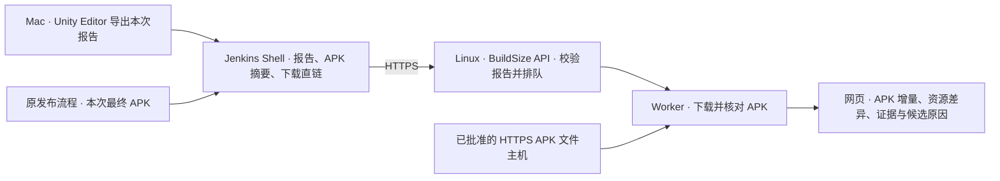

# Jenkins / CLI 接入

当前 CLI 与本机 HTTP、PostgreSQL、Git 集成可验证；真实 Jenkins 控制器、节点、脚本审批和蒲公英任务尚未验证。Jenkinsfile.example 是合并参考，不能覆盖现有 Jenkinsfile。它保留两个原脚本入口，接入时替换为原流水线对应步骤，不创建假的游戏构建或发布脚本。

## 现行流程：Jenkins 上报报告和直链，BuildSize 自动下载 APK



### Linux 一次性配置

1. 在部署配置填写 `APK_DOWNLOAD_HOSTS`，逗号分隔，列出原始直链及其跳转所需的精确主机名，如 `apk.example.com,cdn.example.com`。使用运维已核实的文件主机。默认空值时远程下载关闭。Jenkins 的 `BUILD_URL` 主机仍单独加入 `TRUSTED_LINK_HOSTS`。
2. 在 Linux 更新平台代码，执行 `make stack-build && make stack-up`。Compose 的一次性迁移会自动升级到 `0007_apk_download`，API 与 Worker 需要同时更新。
3. 为目标项目签发 `builds:read` 和 `builds:submit` 权限令牌。Jenkins 在任务构建环境用 **Secret text** 绑定为 `BUILDSIZE_API_TOKEN`。把平台 HTTPS 地址配置为 `BUILDSIZE_API_URL`。使用内网 CA 时，在上报 Shell 里导出 `SSL_CERT_FILE`，脚本会显式加载该 PEM 文件进行 TLS 校验。凭据在上传脚本中使用，无需传给 Unity 插件。

```bash
docker compose --env-file .env.deploy -p buildsize -f deploy/compose.yaml \
  exec api buildsize-admin create-token my-game --scope builds:read --scope builds:submit
```

### Mac 构建前：生成上下文并导出报告

Mac Agent 使用 Python 3.8+、Git 和随仓 `unity-report-handoff.py`。将配置模板按实际目录和分支保存为游戏仓库的 `buildsize-ci.json`，模板里的美术仓只是示例。安装 Editor-only Unity 导出包，在原构建入口启用 `BuildOptions.DetailedBuildReport`。自由风格任务把下面的准备代码放在原 Unity 打包 Shell 开头。原 Unity 命令要在**同一步 Shell**中执行。

```bash
set +x
report_script=/opt/BuildSizeInspector/integrations/jenkins/unity-report-handoff.py
ci_dir="$WORKSPACE/.buildsize/ci/$BUILD_NUMBER/android-release-arm64"

if prepared=$(python3 "$report_script" prepare --directory "$ci_dir" \
  --workspace "$WORKSPACE" --project my-game --variant android-release-arm64 \
  --config "$WORKSPACE/buildsize-ci.json"); then
  BUILDSIZE_RUN_ID=$(printf '%s' "$prepared" | python3 -c 'import json,sys; print(json.load(sys.stdin)["run_id"])')
  BUILDSIZE_REPORT_DIR=$(printf '%s' "$prepared" | python3 -c 'import json,sys; print(json.load(sys.stdin)["report_directory"])')
  export BUILDSIZE_RUN_ID BUILDSIZE_REPORT_DIR
  export BUILDSIZE_EXPORT_MODE=callback BUILDSIZE_IMPORTER_COLLECTION=true
else
  status=$?
  case "$status" in 130|143) exit "$status" ;; esac
  printf '%s\n' 'BuildSize 报告准备失败，继续原打包步骤' >&2
fi
```

最终签名和后处理成功后，记录完成时间。重试上报时使用原记录。

```bash
ci_dir="$WORKSPACE/.buildsize/ci/$BUILD_NUMBER/android-release-arm64"
if [ -s "$ci_dir/context.json" ] && [ ! -e "$ci_dir/completed-at.txt" ]; then
  date -u '+%Y-%m-%dT%H:%M:%SZ' > "$ci_dir/completed-at.txt"
fi
```

### Mac 发布后：上报本次报告与下载直链

现有发布步骤提供**本次最终 APK 的 HTTPS 文件直链**。用原发布逻辑取得实际值并作为 `PGYER_APK_DIRECT_URL`。蒲公英网页安装链接、短链接和仅移动端支持的 `/apiv2/app/install` 不能替代文件直链。Linux 要能在链接有效期内直接读取 APK。不要按应用短链猜测最新版。

发布确认后保存链接文件，关闭 Shell 命令回显。保留本次构建的工作区隔离。

```bash
set +x
ci_dir="$WORKSPACE/.buildsize/ci/$BUILD_NUMBER/android-release-arm64"
if [ -s "$ci_dir/context.json" ] && [ -n "${PGYER_APK_DIRECT_URL:-}" ]; then
  (umask 077; printf '%s\n' "$PGYER_APK_DIRECT_URL" > "$ci_dir/apk-download-url.txt")
fi
```

新增一个「执行 Shell」步骤，替换脚本路径和最终 APK 路径。Jenkins 负责传报告和摘要，APK 字节由后台 Worker 拉取。HTTP 202 表示后台已接受任务。Pipeline 用户可合并 `Jenkinsfile.example`。

```bash
set +x
report_script=/opt/BuildSizeInspector/integrations/jenkins/unity-report-handoff.py
ci_dir="$WORKSPACE/.buildsize/ci/$BUILD_NUMBER/android-release-arm64"
final_apk="$WORKSPACE/BuildOutput/game.apk"

if python3 "$report_script" submit --directory "$ci_dir" --apk "$final_apk" \
  --apk-url-file "$ci_dir/apk-download-url.txt" \
  --completed-at-file "$ci_dir/completed-at.txt" --receipt "$ci_dir/receipt.json"; then
  printf '%s\n' '报告已上报，服务器已接管 APK 下载'
else
  status=$?
  case "$status" in 130|143) exit "$status" ;; esac
  printf '%s\n' 'BuildSize 上报失败，保留重试资料' >&2
fi
```

允许归档为空，归档本次 `receipt.json`，下载链接文件不归档。该文件可能含临时签名，需要按凭据处理。网页先显示等待下载或下载中，校验完成后继续分析。链接过期或失效时，更新本次链接文件，再执行同一上报步骤。保持报告、APK 摘要、完成时间和构建身份一致；下载失败的任务复用原构建重新排队。相同构建重复上报不会重复创建任务。下载或校验失败时，构建详情会显示对应错误。

### 兼容手工补交

省略 `--apk-url-file` 并提供 `--pgyer-build-key` 可继续用原报告上报、Linux `buildsize complete-apk --receipt /path/to/receipt.json --apk /path/to/downloaded.apk` 的手工流程。两种方式均按本次最终 APK 的长度和 SHA-256 校验。完整 Git 文件差异仍可用已安装 CLI 的兼容采集方式。

## 兼容旧流程：直接提交 APK 和报告

以下示例假设已经通过凭据管理设置 BUILDSIZE_API_URL 和 BUILDSIZE_API_TOKEN，不在 shell 历史里赋令牌值：

```bash
buildsize prepare --project demo-game --variant android-release-arm64 --config buildsize-ci.json --output .buildsize/ci/123/context.json
buildsize collect --context .buildsize/ci/123/context.json --apk "BuildOutput/final signed.apk" --completed-at-file .buildsize/ci/123/completed-at.txt --output .buildsize/ci/123/submission
buildsize submit --directory .buildsize/ci/123/submission --receipt .buildsize/ci/123/receipt.json
buildsize status --receipt .buildsize/ci/123/receipt.json --output .buildsize/ci/123/status.json
buildsize link-pgyer --receipt .buildsize/ci/123/receipt.json --result .buildsize/ci/123/pgyer-safe-result.json
```

prepare 从配置/Jenkins 环境合并 CI 身份，读取各仓实际 HEAD 和 dirty。context 包含传给 Unity 的 environment 信息，不含 API token。相同 logical key 稳定派生 UUIDv5 run_id，context 原子创建、拒绝覆盖不同身份/配置。UUID 只作标识，不作授权凭据。新构建必须使用新目录，不能删除旧 context 然后向同一冻结目录重新采集。

collect 只读本 run_id 的 capture-complete.json 列出文件；核对每份文件的长度、SHA 和 run_id，并在复制后复核。回执缺失时不扫描旧报告；可以只依靠明确受控元数据提交 APK，缺失 Unity 层会降级。无报告时至少须明确 application_id/version_name/version_code/channel/settings.export_mode/build_completed_at；其他未知设置为 null。配置与实际 Unity 设置冲突时拒绝，不静默覆盖。原游戏失败不得调用 collect；已知 Failed/Cancelled 报告也会被拒绝。

完成时间使用带时区的最终 APK/CI 时间，参数 --completed-at 或 --completed-at-file（二选一）、BUILDSIZE_BUILD_COMPLETED_AT、受控配置之间必须一致。最终 CI 时间可晚于 Unity Player 完成时间；原 Unity 时间保留在 unity-settings.json，并记录 warning。文件参数有界读取，避免 shell 引号和换行问题。

第一次 collect 将 APK、build-meta、Git 和回执所列报告复制到独立目录，最后发布 submission.json/collection.json。已冻结目录只能核验复用；重试不会刷新 metadata、run_id、时间戳和哈希。源 APK 改变会冲突，不能复用原身份伪装新内容。不要为“重试”重跑 collect 来补报告；sealed 原始产物不可改写。

submit 每次先完整校验冻结清单与文件，初始化后只传未 verified 的角色；每个未完成文件从头重传，没有字节续传。finalize 返回 202 即退出，不等 Worker。相同提交重试不新增构建/任务。回执绑定准确 API 地址和 build_id；status/link-pgyer 缺少回执即失败，绝不选最近构建。迁移 API 地址后需要人工核对回执，不能把旧回执直接发送到新环境。

stdout 为机器 JSON 或 --output 文件，stderr 为脱敏错误。退出码：0 成功、2 本地数据/参数、3 权限/配置、4 网络/服务、5 哈希/协议冲突；SIGINT=130，SIGTERM=143。网络命令可用 --timeout 调整默认 900 秒总期限；连接/408/429/5xx 最多 3 次，指数退避加 jitter，Retry-After 最多等 30 秒且不得越过总期限。401/403/409/413/422 不盲目重试，不跟随任何重定向。

## Git 证据

采集器只运行本地只读 Git，禁用 hooks/fsmonitor、external diff/textconv 和交互式凭据提示；不 fetch，不上传作者、email、remote、提交正文、源码内容或整个环境。仅在小于等于 8 KiB 的 .meta blob 中读取 GUID。NUL 分隔解析保留中文、空格和 rename 的旧/新路径，额外保留 blob ID。每仓有界 30 秒/64 MiB、最多 100,000 个文件差异和 10,000 个提交；配置最多 200 仓、key 最长 128 字符。不能完整采集时非零退出或明确 failed，不把截断当完整结果。

collect 查询同配置/分支/可信 CI 来源的候选基线；浅克隆缺失对象为 missing_base，不自动访问私有 Git。没有配置 API 时为 failed 加 warning，和确实没有前版的 no_baseline 分开。prepare 后 HEAD 改变拒绝收集；dirty 状态保留，但未提交内容不包含在提交差异里。

服务端冻结比较时再次检查实际 base/head，不依赖客户端的 requested_base_build_id。手动换基线或候选期间历史构建晚到时，范围不匹配的旧证据不能复用。提交列表只说明范围，不能证明某开发者导致增长。建议在缺基线时由原检出流程补齐需要的历史对象，再重跑未冻结的采集，或明确接受 Git 缺失。

## 蒲公英结果

现有发布流程写入 `$BUILDSIZE_CI_DIR/pgyer-safe-result.json`。参考 pgyer-safe-result.example.json；只有五个允许字段：publish_state/build_key/build_version/install_page_url/published_at，缺失值显式 null。publish_state 为 publishing/published/failed/not_published；只有最终发布成功才能写 published，且必须有 build_key、可信安装页和带时区发布时间。传输成功后发布失败应写 failed，不提供安装成功链接或发布时间。

CLI 从输入提取白名单；API 拒绝未知字段。URL 禁止 userinfo、token/API key/签名参数，不保存临时带凭据下载地址。不要把蒲公英原始响应重定向到归档目录。普通未成功状态可更新为最终成功；已 published 的同内容请求幂等返回，不同结果返回 409，避免重试覆盖另一个发布版本。

示例只归档 context、完成时间和 receipt。分步提交第一次冻结时需读取 Mac 最终 APK，重试报告上报使用已冻结的报告目录，Linux 补交使用回执和下载的 APK。旧流程重试完整 submit 需要整份冻结目录及原 APK。重试关联只需 receipt 和安全结果。禁止归档令牌、原始蒲公英响应或整个环境。

## 外部验收待办

在实际 Jenkins 上验证控制器/插件/Groovy sandbox、两个 variant/构建号的目录隔离、两次真实任务及以下故障：API 断开、错误 token、上传中断重试、凭据绑定失败、原游戏失败、原发布失败、手动中止和 timeout。核对原发布行为不变，日志/归档无凭据。当前本机 CLI/HTTP/数据库测试不能代替这些验收。
